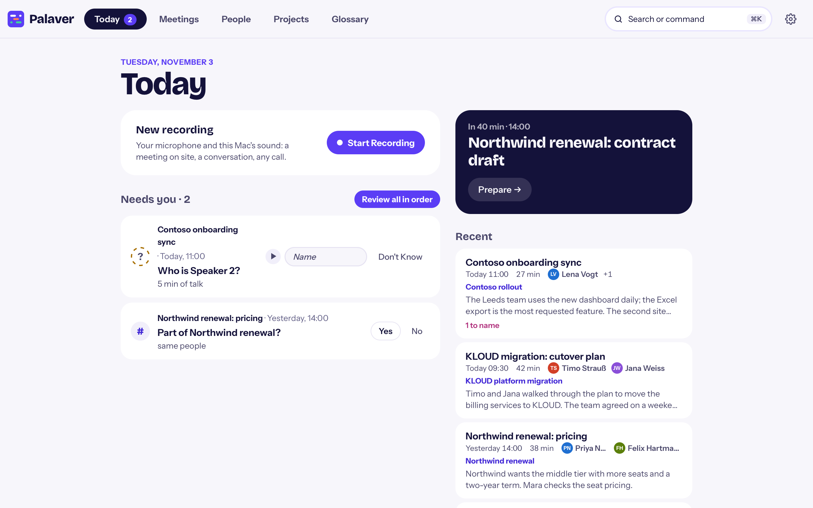
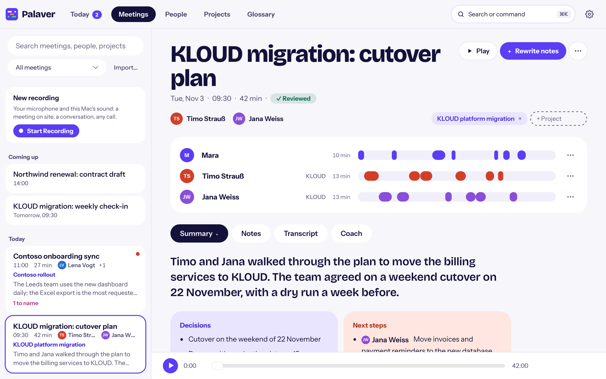
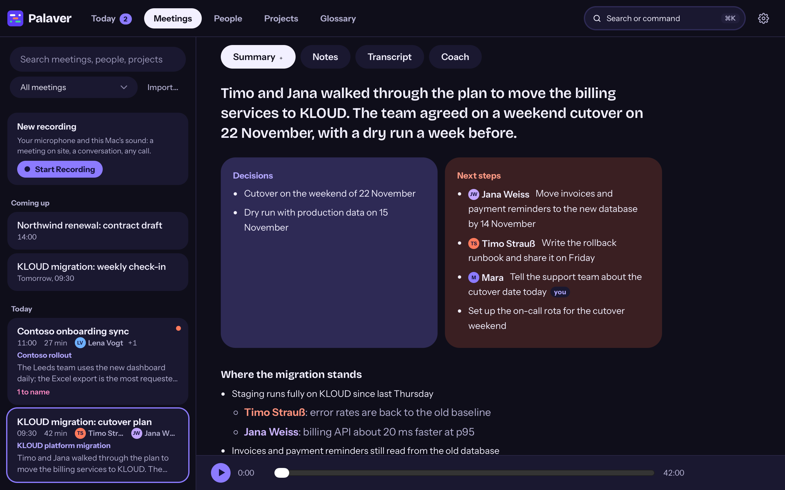
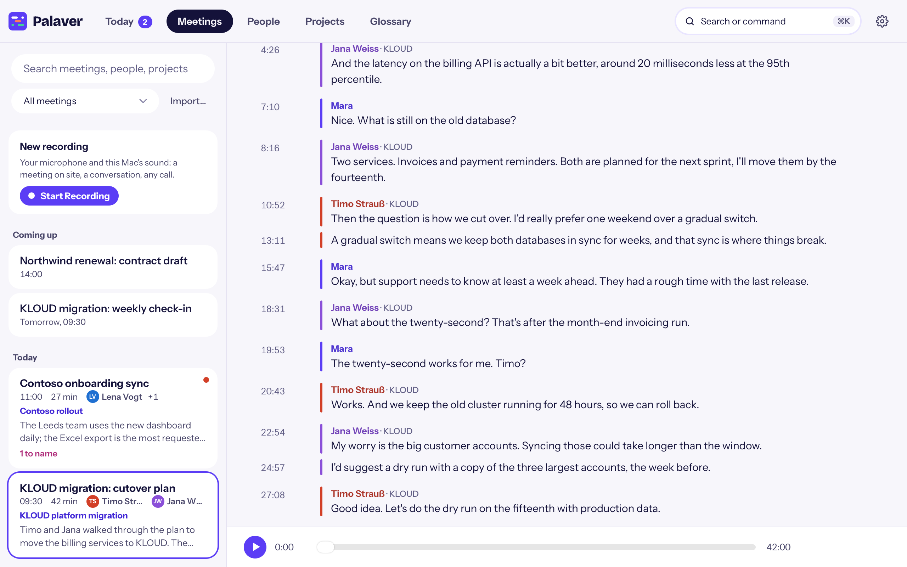
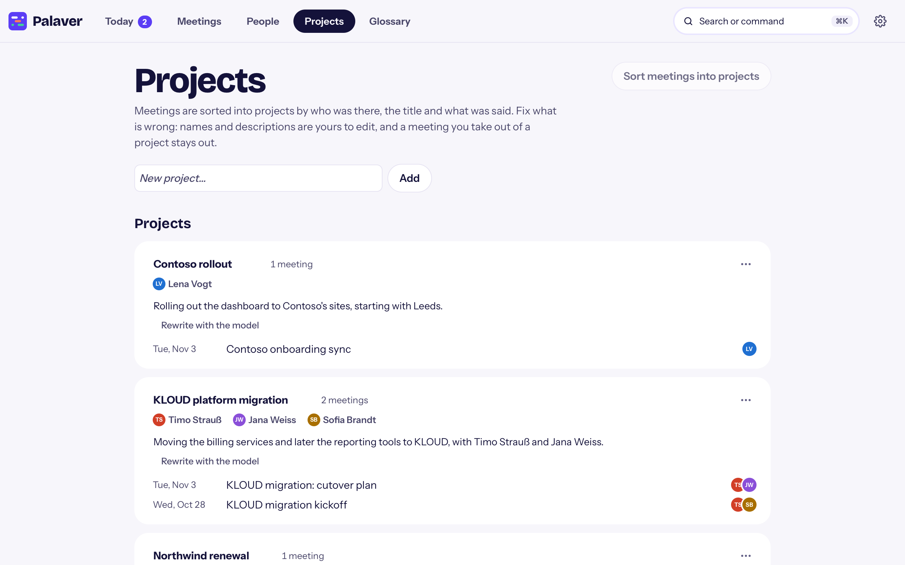

# Palaver

Aus dem Palaver wird ein Plan. Palaver is a meeting notetaker for the Mac
that runs on the Mac. It records your Microsoft Teams calls and Slack
huddles by itself, writes down who said what, and turns the call into notes:
a summary, the topics, decisions and next steps with their owners. The
recording, the transcript and the notes stay on your Mac.



## Why Palaver

- **Private.** Speech recognition, speaker detection and the notes all run
  on your Mac, with local models. Nothing goes to a cloud unless you choose
  a cloud service for a feature yourself.
- **Automatic.** A Teams call or a Slack huddle starts a recording, and the
  end of the call stops it. No bot joins your meeting, and nobody has to
  invite anything.
- **Notes you can use.** Soon after the call, the meeting has its
  transcript, a summary, the topics in order, decisions and next steps with
  owners.
- **It knows who spoke.** Each voice gets a lane. Name a voice once and
  Palaver recognizes it in your next meetings.
- **Organized for you.** Meetings are sorted into projects (a customer, an
  initiative, a topic), people are grouped by organization, and everything
  is searchable.

Palaver was called meeting-transcribe until October 2026; its settings move
to the new folders at the first start.

## What you get



- **Today.** Your start page: the call being recorded, the next meeting in
  your calendar with what led up to it, what needs you (an unnamed voice, a
  project to confirm), and the latest meetings.
- **Automatic recording.** Teams calls and Slack huddles, each with its own
  switch. Palaver notices a call when Teams or Slack uses the microphone,
  so it needs no access to your Teams or Slack account. Muting yourself
  does not end the recording.
- **Record by hand.** "Start Recording" in the window or "Start recording
  now" in the menu bar records anything else: a meeting in the room, a
  phone call on speaker, a call in another app.
- **Live transcript.** Palaver can transcribe during the call (recommended
  with 24 GB of memory or more): open a meeting while it records and the
  transcript builds up, about a minute behind, and the meeting is ready
  seconds after the call. With realtime transcription on (recommended for an
  M2 Pro, M3 or newer with 16 GB or more), the other side's words show up a
  few seconds after they are said.
- **Notes.** Title, a one-line summary, the topics in the order they came
  up, decisions, and next steps with owners. Written by a local language
  model (Gemma 4 12B) in the meeting's language, German or English. Your own
  notes from the Notes tab (text and screenshots) go into them too.
- **Transcript.** Without filler words and stutters. Click a line to hear
  it, fix a word by hand, or cut a recording in two where one call ran into
  the next.
- **Who spoke when.** One lane per speaker. Type a name, or take a
  suggestion: an invitee from the calendar, a voice Palaver knows, or a name
  the conversation reveals ("Hi Timo"). With the calendar and a few
  meetings, many voices name themselves, and Palaver says why it thinks so.
- **Calendar.** Palaver matches a recording to the event in the macOS
  Calendar app (any account added there, such as Microsoft 365 or Google):
  the meeting gets the event's title and invitees. Read-only, on this Mac.
- **Projects.** Meetings join the project they clearly belong to: the same
  people, title words or customer. Otherwise the notes model suggests one.
  Rename, merge and correct projects; a meeting you take out stays out.
- **People.** Everyone you meet, with their organization from their email
  domain: "Timo Strauß (KLOUD)".
- **Search.** Across all notes and transcripts, by words and by meaning
  (⌘K for search and commands, ⌘F in a meeting).
- **Glossary.** Names and terms the transcription gets wrong, differently
  each time. Palaver suggests fixes, and you accept or reject them.
- **Coach.** How you talked in a meeting compared with what is usual for
  you: talk share, monologues, pace, filler words, questions and
  interruptions. Optional quiet nudges during a call. Only your own speech
  is analyzed.
- **Review.** Step through finished meetings one by one: confirm the
  project, name the speakers, check the notes.
- **Share a meeting.** Export a meeting as a .zip and send it to a
  colleague, who imports it into their Palaver.
- **Dark mode.** The window follows your Mac's appearance.







## Requirements

- macOS 15 or later on Apple Silicon (M1 or later)
- About 3 GB of disk for the app and its runtime, plus the models you choose
  in the setup assistant (Parakeet 2.3 GB; the notes model 8 GB or more)
- For notes written on your Mac: enough memory for the notes model. It needs
  about 10 GB while it writes, up to 12 GB for a long meeting. The setup
  assistant says what your Mac can run and recommends the rest.

Nothing else: no Python, Homebrew, Hugging Face account or Notion.

## Install

```bash
curl -fsSL https://raw.githubusercontent.com/kenodressel/palaver/master/install.sh | sh
```

Options: `--autostart` starts Palaver at login, and `--cli` adds the
`palaver` command to `~/.local/bin`:

```bash
curl -fsSL https://raw.githubusercontent.com/kenodressel/palaver/master/install.sh | sh -s -- --autostart --cli
```

The installer writes only into your home folder and changes no shell or
`PATH` setting:

| What | Where | Size | Downloaded |
|---|---|---|---|
| The app: Palaver's code and its launcher | `~/Applications/Palaver.app` | 3 MB | every release |
| Its runtime: Python and every library Palaver uses, prebuilt | `~/Library/Application Support/palaver/runtime/` | 530 MB download, 1.6 GB on disk | only when it changed |
| The models, with your OK in the setup assistant | `~/Library/Application Support/palaver/models/` and `~/.cache/huggingface` | ~12 GB (Parakeet 2.5, Gemma 4 12B 9, search 0.5) | once, again when a model changes |

## First start

Open Palaver (`~/Applications/Palaver.app`). It lives in the menu bar; "Open
Meetings" (⌘M) opens its window.

1. **Setup assistant.** It looks at your Mac (chip, memory, free disk) and
   recommends the settings for it. It downloads the models it needs with
   your OK and shows the progress. An optional test recording checks that
   the microphone and the Mac's sound come through.
2. **Permissions.** macOS asks for **Microphone** and **System Audio
   Recording** under Palaver's name. Palaver does not need Screen Recording.
   You can also connect the **Calendar** (in the setup assistant or Settings
   → Calendar) for meeting titles and invitees.
3. **Your name.** It is how you show up in transcripts: lines from your
   microphone carry it.

`palaver doctor` (with `--cli`) checks the setup, permissions, models and
disk, and says how to fix what is missing.

## Using Palaver

**Recording.** Join a Teams call or a Slack huddle; the menu bar icon shows
🔴 while Palaver records. It stops a few seconds after the call ends. To
record anything else, click "Start Recording" in the window or "Start
recording now" in the menu bar menu. The menu has a switch each for Teams
calls and Slack huddles; with both off, automatic recording is paused.

The menu bar icon says what Palaver is doing: the icon alone while it waits,
🔴 while it records, ⏳ while it transcribes, ⏸ while automatic recording
is paused, ↑ when an update is ready.

**Speakers or headphones.** Both work, and you can switch during a call.
Palaver records your microphone and the Mac's sound as separate tracks and
removes the other side's voices from your microphone track, so they are not
transcribed twice.

**After the call.** The transcript comes first, the notes a little later.
A notification says when they are ready. Open the meeting from Today or
Meetings, name any voice Palaver did not know, and check the notes.

**Before a call.** The next meetings from your calendar are listed under
"Coming up". "Prepare" shows the meetings that led up to it, with their
summary and next steps. You can pick its project and write notes there in
advance.

**A meeting's ⋯ menu** has Export…, Keep on This Mac, Delete Audio… and
Move to Trash, among others. Most changes can be undone.

## Privacy

- **On your Mac by default.** Recording, transcription, speaker detection,
  notes, projects and search all run locally. Recordings are in
  `~/Meetings/Recordings`, settings in `~/.config/palaver`.
- **What goes over the network:** the model downloads you agree to in the
  setup assistant, and the update check: one anonymous request for the
  latest release's `manifest.json` at start, every hour and when you open
  the window. Turn it off in Settings → Updates.
- **Cloud is opt-in, per feature.** Settings → Language Model and Settings →
  Transcription can use a cloud service instead of the local model (see
  below). Nothing goes to the cloud until you choose it, and nothing falls
  back to another service by itself. Settings shows what each feature sends
  where and lists every call to a cloud service.
- **Keep on This Mac.** A meeting marked so in its ⋯ menu is never sent to a
  cloud model or service, and Claude cannot read it through MCP.
- **Voices.** Voice samples are biometric data. They are stored only on this
  Mac, in `~/.config/palaver/voices/`, one file per person, and never
  uploaded. `palaver voices forget "Name"` deletes someone's voice.
- **API keys** for cloud services live in the macOS login Keychain, never in
  a file.
- **Problem reports** are a zip on your Desktop that you send yourself;
  nothing is uploaded.

Recording other people may need their consent where you live. Tell the
people in your meetings that you take notes with Palaver.

## Optional: cloud services

You don't need any of these. Each one is off until you set it up.

- **Language model** (Settings → Language Model): write notes and sort
  projects with the Anthropic API, an OpenAI-compatible endpoint (OpenAI,
  your Azure OpenAI tenant, a company or self-hosted gateway) or the Claude
  Code CLI, chosen per feature. A meeting too long for the model is refused
  with a message, never cut short.
- **Transcription** (Settings → Transcription): AssemblyAI, Soniox (both on
  EU servers by default), Mistral Voxtral or an OpenAI-compatible endpoint.
  Only the Mac's sound (the other side) goes out, after the call; your
  microphone and who spoke when stay on this Mac. If the service fails, the
  meeting is transcribed on this Mac and a notification says so. What the
  service keeps is deleted there once the words are back. Settings shows the
  estimated cost this month.
- **Notion:** each meeting's transcript can be uploaded to a Notion page or
  database after the call (see [Advanced settings](#advanced-settings)).
- **Claude (MCP):** `palaver mcp --install` lets Claude Code read your
  meetings, notes, projects and people, read-only (`--install --desktop` for
  Claude Desktop). Settings → Claude Access shows what Claude read.

## Storage, updates, uninstall

**Storage.** A meeting is about 350 MB of audio per hour plus its transcript
and notes. Settings → Storage shows what the meetings and the models take,
deletes the audio of transcribed meetings after 7, 14, 30 or 90 days (never,
by default), and deletes a notes model no longer chosen. Delete Audio… in a
meeting's ⋯ menu deletes one meeting's audio: its transcript, notes and
speakers stay, but it can't be played or transcribed again.

**Updates.** Palaver looks for a new release at start, every hour and when
you open its window. "Check for Updates…" in the menu bar menu looks now. A
new release is announced once with a notification; until it is installed,
the menu bar shows ↑, the window shows "Update to (version)", and Settings
says what's new. Palaver downloads only what changed, checks it, and
installs at the next moment nothing records, transcribes or writes notes;
then it restarts. A failed update keeps the version you have and says why.
Running the install command again updates too.

**Uninstall.** Settings → Updates → Uninstall Palaver… asks first, then
removes the app, its runtime, the login item and the `palaver` command; the
models only when ticked; your recordings, settings and voices only when
ticked. Or in a terminal:

```bash
curl -fsSL https://raw.githubusercontent.com/kenodressel/palaver/master/install.sh | sh -s -- --uninstall [--models]
```

which keeps recordings, settings and data. Models downloaded from Hugging
Face stay in `~/.cache/huggingface`.

## Command line

With `--cli`, the `palaver` command does from a terminal what the app does,
and a little more:

```bash
palaver doctor                 # check the setup, say what to fix
palaver record                 # record now; Ctrl+C stops
palaver list                   # every recording and its state
palaver run <folder>           # transcribe, write notes (and upload) a recording
palaver rename <folder>        # name the speakers, with a short sample of each
palaver voices                 # whose voices are stored
palaver voices forget "Anna"   # delete someone's voice
palaver export <meeting>       # a meeting as a .zip for a colleague
palaver import <zip>           # a meeting a colleague exported
palaver mcp --install          # let Claude Code read your meetings
palaver --help                 # everything else
```

## Advanced settings

Almost everything is in the window's Settings. A few things live in
`~/.config/palaver/config.toml` (optional; without it the defaults apply):

```toml
[user]
name = "Timo"

[recording]
output_dir = "~/Meetings/Recordings"  # where recordings go
slack = true                          # record Slack huddles (until changed in Settings)
grace_period_seconds = 10             # stop this long after the call ends
max_session_hours = 4                 # stop a recording after this long

[calendar]
enabled = true

[notion]
parent_page_id = "<your-parent-page-id>"  # with a token, meetings upload here
auto_sync = true                          # false: upload by hand (palaver sync <folder>)
```

For Notion, create an internal integration at notion.so/profile/integrations,
share a parent page with it, and put its token in `[notion] token = "…"` or
the `NOTION_TOKEN` environment variable. To file meetings as rows of a Notion
database, share the database with the integration and set `mode =
"database"` and `database_id`. Columns are matched by type and name, and only
those that exist are filled: the title, a date (`Date`/`Datum`), numbers for
duration (`Duration`/`Dauer`) and speakers (`Speakers`/`Teilnehmer`), and a
select `Source` (set to "Teams").

## Troubleshooting

**Something went wrong.** "Report a Problem…" (in the menu bar menu, ⌘K,
Settings, a meeting's ⋯ menu, or an error message) writes one zip to the
Desktop, `Palaver report <date>.zip`, and shows it in Finder: what you
wrote, versions, this Mac's setup, the settings without secrets, the logs,
and the chosen meeting (its audio only when ticked). Nothing is uploaded;
send it to whoever helps you.

**Nothing records when a call starts.** Check that "Record Teams calls
automatically" or "Record Slack huddles automatically" is on (Settings →
Recording, or the menu bar menu) and that automatic recording isn't paused.
`palaver doctor` checks the permissions.

**macOS asks for the permissions again after an update.** macOS remembers
them by the app's signature. Releases are signed with the same certificate
every time, so this should be rare; when the signature changed, Palaver asks
right after its restart, while it is idle, not in the middle of the next
call.

**Notes are missing or late.** Notes wait for enough free memory (about 14
GB for Gemma 4 12B). Settings → Memory shows what each part of Palaver uses.
"Rewrite notes" on the meeting writes them again.

**A name is spelled wrong in every meeting.** Add it to the Glossary, or
accept the Glossary's suggestion. The fix applies everywhere the transcript
is shown, searched or summarized.

**Two calls ended up in one recording.** Hover over the transcript line
where the second call starts and press ✂. "Join with the one before/after"
puts a split call back together.

## Contributing

Palaver is written in Python, with a WKWebView window. To build it from
source, run the tests or make a release, see [CONTRIBUTING.md](CONTRIBUTING.md).
Third-party licenses are in [THIRD_PARTY_LICENSES.md](THIRD_PARTY_LICENSES.md).
